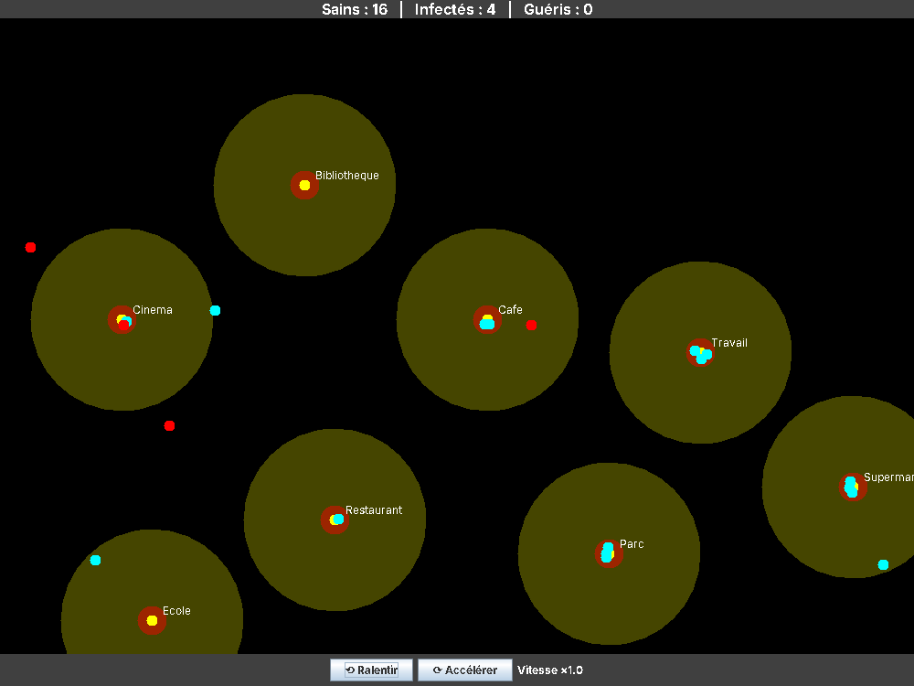

# Epidemic Spread Simulation

Real-time simulation of a virus spreading through a population of autonomous agents, with a Python simulation engine and a Java graphical interface talking to each other over TCP sockets.

Group project done during my 2nd year of MIASHS at Université Paul-Valéry Montpellier 3 (2025-2026), with Ilian Ikdoumi and Hicham Sabri.



*Cyan: healthy agents · Red: infected agents · Circles: places of the virtual city. The top bar shows live counts, the bottom bar controls the speed.*

## How it works

The project is split into two programs running at the same time:

- a **Python engine** handles the simulation logic: agents, movement, infection, threads
- a **Java (Swing) application** draws the city and the agents in real time

Python acts as the server and Java as the client. Tick by tick, Python sends each agent's name, position and health state; Java sends back speed changes when the user clicks *Ralentir* / *Accélérer*.

## Main features

- **20 agents**, each following its own daily route between 8 places (school, library, park, work, supermarket, café, cinema, restaurant)
- **Continuous movement** with an A* algorithm adapted to work with angles instead of cell by cell
- **Vision system**: each agent only discovers the map progressively through its field of view (radius 4, 120° angle)
- **Memory grid** per agent (unknown / safe / place), used by A* to plan routes and avoid obstacles
- **Exploration** of the map in four quadrants, searched one after another
- **Infection model**: healthy → infected → immune. An agent can be infected when it gets close to an infected agent (distance below 0.5, 5% chance per tick), and becomes immune after visiting 6 places while infected
- **Collision avoidance**: agents that get too close automatically move apart
- **Multithreading**: one thread per agent, synchronized between cycles
- **Live statistics** (healthy / infected / recovered) and speed controls on the Java side

## My contribution

I was mainly in charge of the **Java application**: the main window (`MainApp`), the real-time rendering of places and agents (`PanelSimulation`, `Agent`), and the client that receives data from Python (`NetworkThread`). I also took part in every other part of the project with the team: the Python engine, the socket protocol, testing and the report.

## Tech stack

- **Python** — simulation engine (agents, A*, infection, threads)
- **Java (Swing)** — graphical interface
- **TCP sockets** — Python ↔ Java communication

## Run it

Requirements: Python 3 and a JDK (Java 8 or newer). No external library is needed.

1. Start the Python server first (it waits for the Java client on port 5061):

   ```bash
   cd python
   python Start_Infection.py
   ```

2. In a second terminal, compile and start the Java interface:

   ```bash
   cd java/src
   javac *.java
   java MainApp
   ```

## Repository content

- `python/` — simulation engine (`Start_Infection.py`, `Agent.py`, `a_star_2d.py`, `personnes.py`)
- `java/src/` — Swing application (`MainApp`, `PanelSimulation`, `Agent`, `NetworkThread`)
- `report/` — full project report (in French), week by week
- `images/` — screenshot of the simulation

## Team — Group 13

Adem Ejebli, Ilian Ikdoumi, Hicham Sabri.

The same project is also on Ilian's GitHub: [Ikdoumi-Ilian/epidemic-spread-simulation](https://github.com/Ikdoumi-Ilian/epidemic-spread-simulation).
